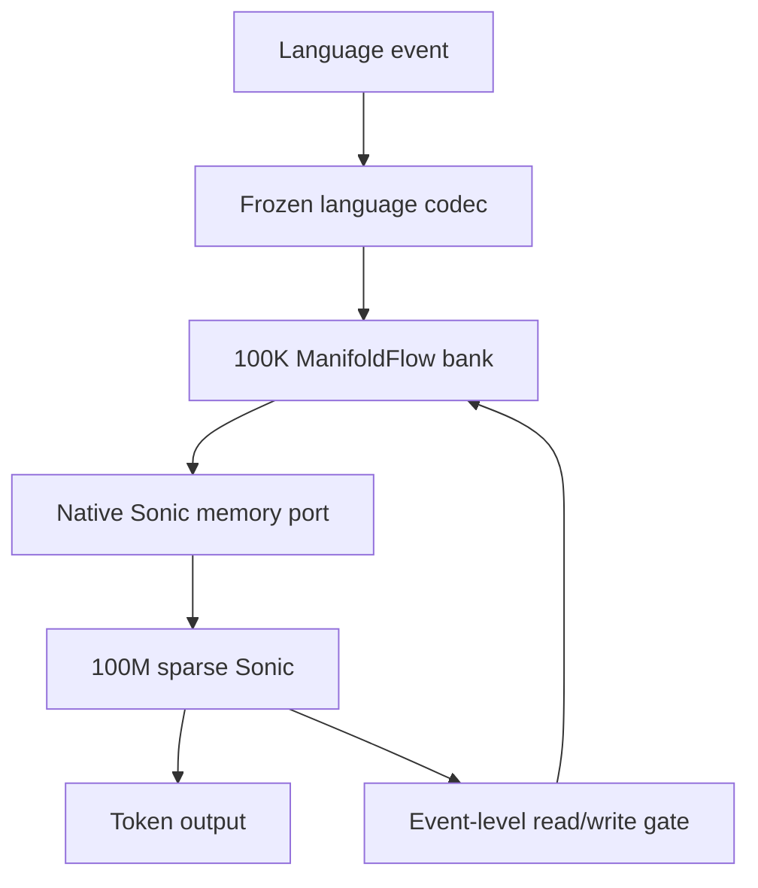
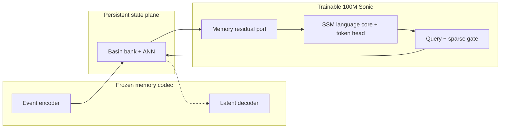
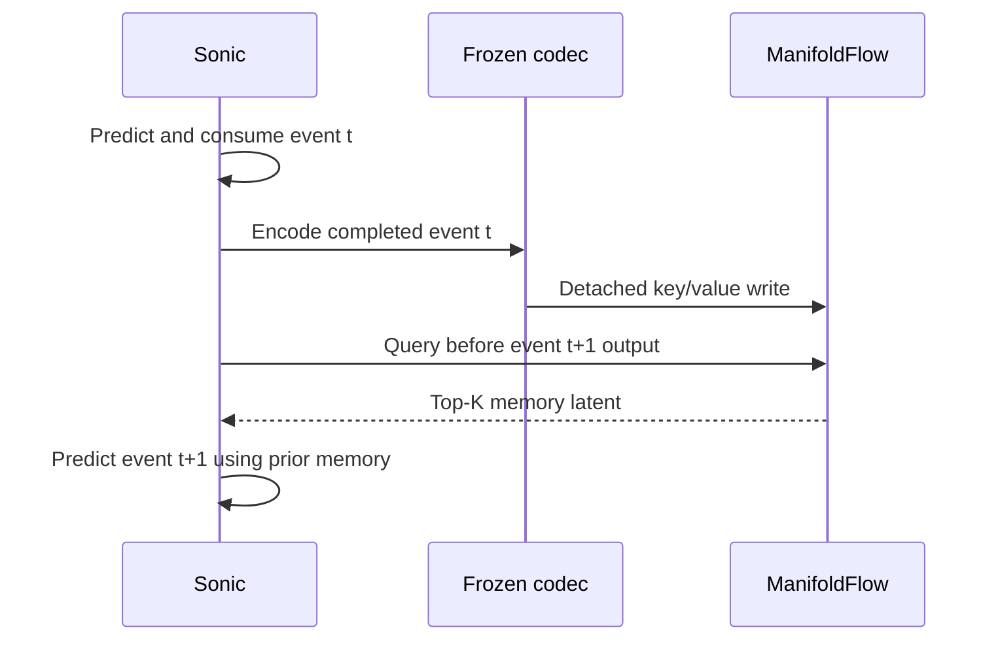
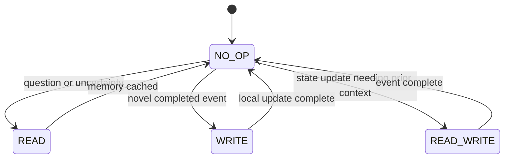
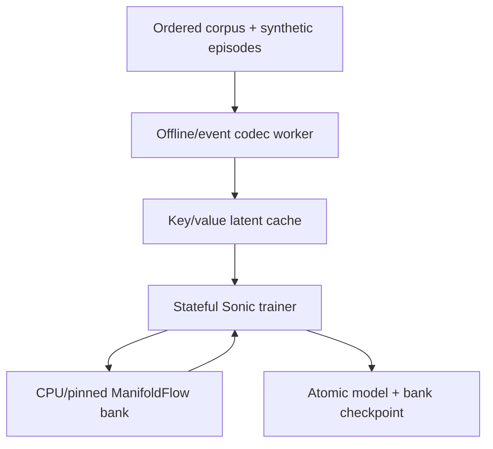

# ManifoldFlow–Sonic Language World Model — Design Doc v0.4

*A 100M sparse-activation Sonic trained from the beginning to treat ManifoldFlow as native persistent state.*

**Status:** Proposed successor to completed ManifoldFlow v0.3 Phase 6  
**Initial modality:** Language only  
**Trainable model:** Sonic, approximately 100M parameters  
**Persistent state:** ManifoldFlow, initial capacity 100K basins  
**Memory codec:** Frozen pretrained language encoder/decoder  
**Online learning:** Local basin updates; no optimizer state for the bank  
**Primary objective:** Train Sonic to read, use, and selectively update persistent geometric state that survives ordinary context and optimizer-step boundaries.

---

## 0. Executive Summary

This design replaces the Qwen proof-of-concept shell with a native ManifoldFlow–Sonic architecture. Sonic remains a causal language model and produces tokens through its own trainable language head. A separate frozen pretrained language codec turns completed language events into stable basin keys and value latents. ManifoldFlow stores those latents in a sparse 100K-capacity bank. Sonic retrieves only a small active set at event boundaries and receives the resulting memory through a low-rank residual port. A trained event-level sparse gate decides whether to read, write, read-and-write, or do nothing.

The frozen codec is **not** a continuously running 4B verbalizer and does not generate Sonic's ordinary output. Its role is limited to stable memory I/O:

- the encoder converts completed language events into geometry and payload latents;
- the decoder anchors what the payload latent means and may reconstruct it for training diagnostics;
- Sonic learns to use the stored latent directly, without decoding every memory back into prompt tokens.



ManifoldFlow persists between optimizer steps, but persistence follows coherent streams. It must not become one undifferentiated global cache shared across randomly shuffled documents, training lanes, validation, and test. Each lane carries a stable scope across steps; the bank and active state reset, fork, or change scope only at explicit world/document/episode boundaries.

The core hypothesis is:

> A 100M Sonic can learn substantially stronger long-horizon binding, state tracking, correction, and conversation continuity when a sparse geometric memory is present from the first training stage and is treated as native recurrent state rather than prompt retrieval added after pretraining.

---

## 1. Inheritance from v0.3

This design preserves the mechanisms that survived the v0.3 experiments:

- D128 latent geometry is a strong initial operating point.
- RBF/Euclidean scoring is the default; analytic flow remains disabled.
- ANN routing and local basin updates are inexpensive relative to LM execution.
- Context persistence must fade gradually rather than disappear instantly.
- Low `alpha` can create context-pinning collapse, so current observations require a protected route.
- Main-plus-delta indexing permits foreground writes and background consolidation.
- Consolidation must be versioned and atomically published.

This design changes the role of the language model:

| Qwen proof-of-concept | Native Sonic target |
| --- | --- |
| Memory retrieved as text | Memory read as latent state |
| Prompt injection | Low-rank residual memory port |
| Qwen owns generation | Sonic owns generation |
| External harness chooses memory use | Sonic gate learns event-level memory actions |
| Proves persistent recall | Trains persistent state into the architecture |
| Large model available per interaction | 100M model intended for continuous edge use |

---

## 2. Goals and Non-Goals

### 2.1 Goals

1. Train Sonic with the ManifoldFlow interface present from the first optimizer step.
2. Preserve basin state across optimizer steps within coherent training streams.
3. Retrieve and write only at language-event boundaries, not at every token.
4. Keep the bank outside autograd and update it with detached local rules.
5. Make memory useful for tasks that cannot be solved from the current token context alone.
6. Preserve ordinary language modeling when memory is empty, irrelevant, stale, or disabled.
7. Learn a sparse gate that minimizes unnecessary reads, writes, and codec execution.
8. Keep the architecture ready for later audio and vision codecs without including them in v0.4.

### 2.2 Non-goals

- End-to-end training of the frozen language codec.
- Running an autoregressive external decoder for every memory read.
- Performing ANN retrieval at each generated token.
- Treating the training bank as an unrestricted copy of the entire corpus.
- Sharing live episodic state across unrelated batch lanes.
- Claiming that 100K occupied basins is optimal. It is an initial capacity ceiling.
- Adding vision or audio before the language-only causal protocol is validated.
- Reintroducing analytic flow before RBF memory has been fully characterized.

---

## 3. Architectural Roles



### 3.1 Frozen language codec

The codec must provide:

```python
class FrozenLanguageCodec:
    def encode_key(self, completed_event_tokens) -> Vector[D_key]: ...
    def encode_value(self, completed_event_tokens) -> Vector[D_value]: ...
    def decode_value(self, value_latent) -> DiagnosticReconstruction: ...
```

Requirements:

- deterministic under a fixed model, tokenizer, pooling rule, and precision;
- causally applied only to completed events;
- encoder output stable enough for long-lived retrieval;
- decoder non-autoregressive in the hot path, or absent from the hot path entirely;
- codec revision recorded in every bank checkpoint;
- small enough for event-driven deployment or capable of offline precomputation during training.

The canonical runtime reads stored value latents directly through Sonic's trainable read adapter. The frozen decoder is used for representation anchoring, reconstruction tests, payload inspection, and optional cold-memory rendering. If the decoder requires a full autoregressive generation loop, it is prohibited from routine retrieval.

### 3.2 Sonic

Sonic remains responsible for:

- causal next-token modeling;
- forming memory queries from current hidden state;
- deciding whether memory is needed;
- integrating retrieved value latents;
- deciding whether a completed event should be written;
- producing language through its own token head.

The approximately 100M count refers to trainable Sonic parameters, including the sparse gate and memory adapters, but excluding frozen codec parameters and external basin state.

### 3.3 ManifoldFlow

ManifoldFlow remains responsible for:

- persistent geometric addressing;
- sparse top-K retrieval;
- local statistical writes;
- fading context bias;
- novelty-based basin creation;
- main-plus-delta indexing;
- merge, split, prune, and reindex consolidation.

It does not need to understand entities, grammar, or explicit symbolic relations. Meaning remains in the learned key and value geometry.

---

## 4. Language Event Timing and Causality

The world model is event-driven. A language event is initially one of:

- completed user turn;
- completed assistant turn;
- sentence boundary;
- paragraph/document boundary;
- explicit state-update marker in synthetic training;
- fixed maximum segment length when no semantic boundary appears.

Use 64–256 tokens per event initially, with turn boundaries taking precedence. Retrieval and writes occur once per event, not once per token.

### 4.1 Causal ordering

The codec must never encode a segment and feed that memory back while Sonic is still being trained to predict the same segment. That would leak future tokens.



The invariant is:

> An event may influence only later tokens, never its own earlier prediction targets.

### 4.2 Query timing

For a user-question/assistant-answer pair:

1. Sonic consumes the completed user question.
2. The query is formed from the resulting causal hidden state.
3. ManifoldFlow retrieves relevant prior events.
4. The memory vector is injected before assistant-answer generation.
5. After the assistant event completes, it may be written according to the source/write policy.

For continuous documents, the hidden state at the previous segment boundary queries memory for the next segment. A fixed-length fallback creates boundaries where natural segmentation is unavailable.

---

## 5. Basin Record and Initial Capacity

### 5.1 Canonical v0.4 basin

The first language basin remains deliberately compact:

```text
center[D_key]        FP16
width                FP16 scalar
value[D_value]       FP16
count                 integer
strength              FP16/FP32
last_access_step      integer
scope_id              integer
flags/version         compact metadata
```

Initial dimensions:

- `D_key = 128`
- `D_value = 256`
- isotropic RBF width, not a diagonal energy tensor
- `K_active = 4`
- `M_candidates = 32` initially

RBF scoring is:

\[
s_i(q)=\exp\left(-\frac{\lVert q-\mu_i\rVert^2}{2\sigma_i^2}\right).
\]

Flow and per-axis energy curvature are disabled. Existing results indicate that the simpler geometry is both faster and usually more accurate.

### 5.2 Why 100K basins

100K is an initial **capacity**, not a target occupancy or a declaration of model size. It is large enough to test long-lived sparse state while remaining operationally modest.

Approximate compact serving storage per basin:

| Field | Approximate bytes |
| --- | ---: |
| D128 center, FP16 | 256 |
| D256 value, FP16 | 512 |
| Scalar width and strength | 4–8 |
| Count, timestamp, scope, flags | 24–40 |
| Approximate total before alignment | 796–816 |

At 100K occupied basins, the compact records require roughly 80–100 MB after alignment. The ANN index, delta index, update statistics, allocator overhead, and optional FP32 accumulators likely place the live bank in the approximate 150–300 MB range. Only active records enter accelerator memory.

The 100K bank should grow from empty. Preallocating address space is acceptable; prepopulating meaningless basins is not.

### 5.3 Indexing

Reuse the v0.3 main-plus-delta design:

- immutable/versioned main ANN index;
- exact small delta index for new or materially moved basins;
- top-M union and exact RBF rerank;
- background consolidation and atomic index swap.

For early correctness tests, a batched exact scan may be retained as an oracle. ANN becomes the canonical runtime only after recall against the exact winner is measured.

---

## 6. Native Sonic Memory Port

### 6.1 Query

At an event boundary, Sonic pools a causal hidden state `h_t` and constructs:

\[
q_t=\operatorname{normalize}(W_q h_t).
\]

The frozen codec may also provide a content key from the completed event, `e_t`. The protected hybrid query is:

\[
q_t^{*}=\operatorname{normalize}\left(
\alpha_t e_t+(1-\alpha_t)q_t
\right),
\]

with a raw-content candidate path preserved. Initially:

- `alpha_t` is clamped to `[0.5, 1.0]`;
- both `e_t` and `q_t*` retrieve candidates;
- their candidate union is reranked;
- current content cannot be removed from consideration by persistent context.

This carries forward the v0.3 defense against low-alpha context pinning.

### 6.2 Sparse read

For top-K basin values `v_i`:

\[
w_i=\operatorname{softmax}(\log s_i/\tau),
\qquad
m_t=\sum_{i\in\mathcal K}w_i v_i.
\]

The D256 memory vector enters Sonic through a low-rank residual adapter at one or two selected depths:

\[
h_{\ell,t}'=h_{\ell,t}+
g_{\ell,t}U_\ell\phi(V_\ell m_t).
\]

Only `U`, `V`, the memory gate, and Sonic are trainable. The retrieved basin values are detached constants.

The selected memory vector is cached for the remainder of the event. No ANN query is performed for each output token.

### 6.3 Local write

The first stable write path uses the frozen codec rather than asking an untrained Sonic to invent memory values:

\[
k_t=E_{key}(x_t),\qquad
p_t=E_{value}(x_t).
\]

If a compatible basin `i` exists:

\[
\mu_i' = \mu_i+\eta_i(k_t-\mu_i),
\]

\[
v_i'=(1-\eta_v)v_i+\eta_v p_t.
\]

Otherwise, create a staged microbasin when novelty and write policy permit.

All writes are detached from autograd. Optimizer steps never update basin tensors.

Later phases may allow Sonic to add a bounded residual payload:

\[
p_t'=p_t+\delta_t,\qquad
\lVert\delta_t\rVert\le\delta_{max},
\]

but codec-only values are the safe initial target.

---

## 7. Event-Level Sparse Gate

Language-only v0.4 uses a small gate with four actions:

```text
NO_OP
READ
WRITE
READ_WRITE
```



The gate runs once per event boundary. Its inputs may include:

- pooled Sonic hidden state;
- codec-key novelty;
- best RBF score and margin;
- current context strength;
- event-boundary type;
- whether the next span is a response target.

Training begins with oracle or heuristic gate labels on synthetic episodes. The gate is gradually allowed to choose actions, with a compute penalty discouraging unnecessary operations.

Future modality actions can extend the same interface:

```text
READ_LANGUAGE
ENCODE_AUDIO
ENCODE_VISION
DECODE_AUDIO
DECODE_VISION
```

No multimodal experts are implemented in v0.4.

---

## 8. Persistent State Across Training Steps

### 8.1 Stateful stream lanes

Ordinary shuffled language-model batches destroy world continuity. The dataloader must expose coherent lanes:

```text
optimizer step n:     lane 0 event 12 | lane 1 event 44 | lane 2 event 7
optimizer step n+1:   lane 0 event 13 | lane 1 event 45 | lane 2 event 8
optimizer step n+2:   lane 0 event 14 | lane 1 event 46 | lane 2 event 9
```

Each lane carries across steps:

- `scope_id`;
- persistent context vector;
- active basin IDs and cached memory;
- event position and reset markers;
- optionally detached Sonic recurrent state if the training regime already supports stateful truncation.

The bank is physically shared but retrieval is filtered to:

1. globally permitted basins; and
2. the current lane's scope.

This requires only a compact scope field; it does not create a symbolic database.

### 8.2 Reset semantics

Reset or fork state on:

- explicit end of synthetic world/episode;
- unrelated document boundary;
- user/session boundary when isolation is required;
- evaluation start;
- corrupted or invalid training sample;
- codec/bank version change.

Do **not** reset merely because an optimizer step completed.

### 8.3 Detachment

Persistent state survives, computational graphs do not:

```python
loss.backward()
optimizer.step()

lane_state = detach(lane_state)
bank.commit_detached_writes()
```

This prevents unbounded backpropagation through training history while retaining the resulting world state.

### 8.4 Separate banks for evaluation

Maintain distinct train, validation, and test banks. Never expose held-out events to the training bank.

Report three evaluation modes separately:

| Mode | Starting bank | Measures |
| --- | --- | --- |
| Cold | Empty | Sonic's ordinary learned competence |
| Episodic online | Fresh per episode | Ability to acquire and use new state |
| Lifetime | Approved training/deployment snapshot | Utility of accumulated persistent knowledge |

This prevents corpus memorization from masquerading as architectural generalization.

---

## 9. Training-System Architecture

The existing 16 GB training GPU should not also host a large frozen codec if Sonic already consumes most accelerator memory.



### 9.1 Static corpus

Precompute frozen-codec event keys and values while preserving:

- source sequence order;
- event boundaries;
- document/episode IDs;
- codec revision;
- token offsets;
- reset/fork markers.

The cache is an optimization, not a change in semantics. Sonic still receives memory only after the corresponding event has been causally consumed.

### 9.2 Dynamic synthetic data

For on-the-fly randomized distractor episodes:

- run a small codec worker asynchronously on CPU or another device; or
- construct codec latents from cached templates when the transformation is valid;
- queue events ahead of the trainer;
- never block Sonic's hot loop on a large external model.

### 9.3 Bank placement

- Basin bank and ANN index: CPU RAM or pinned memory.
- Candidate IDs and active values: copied to accelerator per event batch.
- Active working set: cached on accelerator until the event completes.
- No full-bank gradient buffers or Adam state.

---

## 10. Training Curriculum

The memory interface is present from step zero, but its difficulty and autonomy are staged.

### Stage 0 — Causal plumbing

- Insert event boundaries into the dataloader.
- Persist lane scopes across optimizer steps.
- Implement post-event codec writes and pre-response reads.
- Verify that shifting target tokens changes no earlier memory input.
- Train with the memory residual gate initialized near zero on ordinary text.

**Exit gate:** Automated leakage tests prove that no memory contains tokens from the target span being predicted.

### Stage 1 — Oracle read, deterministic write

- Write every trusted synthetic fact/event after completion.
- Provide the known relevant basin ID during memory-required episodes.
- Train Sonic's read adapter and use gate.
- Apply memory dropout on ordinary language examples.

**Exit gate:** Correct memory improves delayed-answer accuracy; shuffled memory damages it; memory-off quality remains stable.

### Stage 2 — Learned query

- Replace oracle retrieval with exact/ANN candidates.
- Train `W_q` with a contrastive target against the known source basin.
- Include hard negatives with the same relation and different entity/value.
- Preserve the raw codec-key candidate route.

**Exit gate:** Candidate recall contains the correct source at the target rate and instance confusion remains bounded.

### Stage 3 — Learned sparse read gate

- Train `NO_OP` versus `READ` on memory-required and memory-irrelevant events.
- Add a small expected-compute penalty.
- Cache one retrieval for the whole response event.
- Include empty-bank and low-confidence trials.

**Exit gate:** Read frequency falls without materially reducing memory-task accuracy.

### Stage 4 — Learned write gate

- Introduce `WRITE` and `READ_WRITE` labels.
- Include repeated facts, disposable details, corrections, and explicit no-write content.
- Keep codec value generation deterministic.
- Stage novel writes before promotion.

**Exit gate:** Required events remain retrievable while bank growth stays within budget.

### Stage 5 — Persistent multi-step streams

- Run randomized worlds across many optimizer steps.
- Sample distraction lengths through and beyond the ordinary token context.
- Include state updates and corrections after long gaps.
- Preserve state between steps and detach graphs.

**Exit gate:** Recall follows a graded curve and remains above cold/stateless performance without current-input collapse.

### Stage 6 — Mixed language training

Use a representative mixture such as:

- 35–45% randomized memory/distractor reasoning;
- 20–30% ordinary educational/web language;
- 10–20% dialogue and stateful conversation;
- remaining coding, math, correction, and instruction-following data.

The exact mixture should follow measured ordinary-language retention and memory use, not become a fixed doctrine.

**Exit gate:** Memory tasks improve without a material regression in held-out ordinary language perplexity or generation quality.

### Stage 7 — Consolidation under training

- Run v0.3 merge, split, prune, and reindex on snapshots.
- Replay compatible foreground deltas.
- Atomically publish the new bank.
- Continue the same stream lanes after version swap.

**Exit gate:** Consolidation does not create causal leaks, scope collisions, or significant evaluation loss.

---

## 11. Objectives

The primary objective remains causal language modeling:

\[
\mathcal L_{LM}=-\sum_t\log P(x_t\mid x_{<t},m_{<t}).
\]

Auxiliary objectives are applied only at event boundaries.

### 11.1 Retrieval contrast

For known source basin `i+` and hard negatives `j`:

\[
\mathcal L_{ret}
=-\log\frac{\exp(q\cdot\mu_{i+}/\tau)}
{\exp(q\cdot\mu_{i+}/\tau)+\sum_j\exp(q\cdot\mu_j/\tau)}.
\]

### 11.2 Gate supervision and compute

\[
\mathcal L_{gate}=\operatorname{CE}(g_t,g_t^{oracle}),
\]

\[
\mathcal L_{compute}=\mathbb E[\text{reads}+\kappa\,\text{writes}].
\]

### 11.3 Memory-use contrast

For selected episodes, compare correct and shuffled memory:

\[
\mathcal L_{use}
=\max\left(0,
\delta+\mathcal L_{answer}^{correct}
-\mathcal L_{answer}^{shuffled}
\right).
\]

This forces the model to use the memory's content rather than merely treating memory presence as a generic prompt.

### 11.4 Fresh-input override

Train corrections and contradictory-current-evidence episodes so stale memory cannot dominate:

\[
\mathcal L_{override}=\operatorname{CE}
(P_{answer},y_{current}).
\]

### 11.5 Combined objective

\[
\mathcal L=
\mathcal L_{LM}
+\lambda_r\mathcal L_{ret}
+\lambda_g\mathcal L_{gate}
+\lambda_u\mathcal L_{use}
+\lambda_o\mathcal L_{override}
+\lambda_c\mathcal L_{compute}.
\]

Begin auxiliary weights small enough that ordinary language learning remains stable. Log each term separately.

---

## 12. Anti-Shortcut and Anti-Collapse Tests

The training harness must continuously run:

1. **Empty memory:** Sonic must still produce coherent language.
2. **Correct memory:** Required delayed questions should improve.
3. **Shuffled values:** Performance should fall specifically on memory-dependent items.
4. **Wrong same-type memory:** Detect class-level rather than instance-level shortcuts.
5. **Stale memory plus current correction:** Current evidence must win.
6. **Memory present but irrelevant:** Gate should choose `NO_OP` or ignore it.
7. **Bank reset between source and query:** Accuracy should return toward the stateless floor.
8. **Fresh nonce worlds:** Prevent pretrained or corpus knowledge from answering.
9. **Cross-lane collision:** One lane must not retrieve another lane's episodic state.
10. **Future-token sentinel:** A random target-only marker must never appear in pre-target memory.

A configuration is rejected if memory-required accuracy rises while current-input or memory-off language quality collapses. This is the language analogue of the v0.3 `alpha=0.3` failure.

---

## 13. Checkpoint and Resume Semantics

A valid training checkpoint is a consistent world snapshot containing:

```text
Sonic weights
optimizer and scheduler
sparse gate and memory adapters
main basin bank version
delta index and pending writes
ANN index version
lane scopes and context state
dataloader stream cursors
codec manifest and latent-cache version
RNG states
consolidation replay position
```

The model checkpoint and bank snapshot must be committed together. Loading Sonic weights with a mismatched bank is an invalid resume unless explicitly starting a cold-memory evaluation.

Writes occurring during checkpoint creation must enter either the old committed version or the next delta log, never disappear between them.

---

## 14. Initial Configuration

```yaml
sonic:
  trainable_parameters: approximately_100M
  causal_lm_head: trainable
  memory_ports: 1_to_2
  memory_adapter: low_rank
  memory_retrieval_per_token: false

language_codec:
  pretrained: true
  frozen: true
  hot_path_autoregressive_decode: false
  static_corpus_latents: precomputed

events:
  preferred_boundaries: [turn, sentence, paragraph]
  fallback_max_tokens: 128
  retrieval_frequency: once_per_event
  write_timing: after_event_loss

bank:
  capacity: 100000
  initial_occupancy: 0
  key_dimension: 128
  value_dimension: 256
  center_dtype: fp16
  value_dtype: fp16
  width: scalar
  scoring: rbf
  flow_enabled: false
  candidate_count: 32
  active_basins: 4
  storage: cpu_or_pinned_ram
  index: main_plus_delta_ann

context:
  alpha_range: [0.5, 1.0]
  initial_alpha: 0.6
  initial_decay: 0.95
  raw_content_candidate_path: true
  persist_across_optimizer_steps: true
  reset_on_step_boundary: false
  reset_on_world_boundary: true

gate:
  granularity: event
  actions: [NO_OP, READ, WRITE, READ_WRITE]
  initial_mode: oracle_then_learned
```

These are testable starting values, not final hyperparameters.

---

## 15. Instrumentation

Every event trace should contain:

```text
training_step, lane_id, scope_id, event_id
token span and boundary type
bank/index/codec versions
gate logits and selected action
raw and learned query candidates
correct-source rank when known
RBF scores, margins, and selected weights
memory residual norm by port
write/update/create/no-op decision
bank occupancy and delta-index size
memory read/write/transfer latency
ordinary LM and auxiliary losses
reset/fork markers
```

Dashboard summaries should include:

- ordinary held-out perplexity with memory off and on;
- memory-required accuracy by distraction length;
- candidate recall@M and hit@K;
- read/write/no-op rates;
- fresh-input override accuracy;
- cross-lane contamination rate;
- bank occupancy, churn, and merge/split/prune counts;
- CPU RAM, GPU working-set bytes, and p50/p95 event latency;
- codec preprocessing throughput and trainer stall time.

---

## 16. Risks and Design Responses

| Risk | Consequence | Design response |
| --- | --- | --- |
| Full-event future leakage | Artificially excellent LM loss | Encode/write only after event prediction |
| Random batch persistence | Unrelated worlds contaminate one another | Stateful lanes and scoped retrieval |
| Bank memorizes validation | False generalization | Separate train/validation/test banks |
| Sonic ignores memory | No benefit over baseline | Nonce tasks, shuffled-memory contrast, oracle warmup |
| Sonic depends on memory for grammar | Empty-bank collapse | Memory dropout and ordinary-language mixture |
| Context pins retrieval | New evidence ignored | Raw candidate path and alpha floor |
| Frozen codec dominates compute | Throughput advantage disappears | Precompute static latents; no hot-path decoding |
| Retrieval per token | ANN cost scales with generation length | Retrieve once per event and cache |
| Bank fills with trivial spans | Capacity wasted | Learned write gate, novelty staging, pruning |
| Early learned writes corrupt state | Unstable training | Codec-only values first; bounded Sonic residual later |
| Codec upgrade invalidates keys | Old bank becomes unreadable | Versioned bank; rebuild or migrate from retained sources |
| Optimizer resume without bank | Behavioral discontinuity | Atomic model-plus-world checkpoint |

---

## 17. Success Criteria

The language-only world-model Sonic succeeds when:

1. It retains ordinary language quality when the bank is empty or disabled.
2. It recalls randomized bindings and state updates beyond the active token context.
3. Basin state persists correctly across optimizer-step boundaries.
4. No causal leakage is detected by target-only sentinels.
5. Correct memory helps and shuffled memory predictably hurts only dependent tasks.
6. Current corrections override stale basin state.
7. Cross-lane episodic contamination is statistically indistinguishable from zero.
8. The learned gate skips most unnecessary memory operations.
9. Retrieval occurs once per event, not once per token.
10. Bank and index overhead remain small relative to Sonic training and generation.
11. New information becomes usable through local writes without updating Sonic weights.
12. Consolidation preserves both retrieval quality and training continuity.

The strongest defensible result is:

> A 100M Sonic trained from inception with a persistent ManifoldFlow state plane acquired and used new language-world information across context and optimizer-step boundaries, while online memory updates remained sparse, local, and gradient-free.

---

## 18. Implementation Order

1. Define the frozen codec interface and choose D128/D256 key/value outputs.
2. Add causal event boundaries and post-event write queues to the trainer.
3. Implement stateful stream lanes and explicit reset/fork markers.
4. Connect the completed v0.3 bank/index/consolidation system at 100K capacity.
5. Add one low-rank memory port to Sonic with its gate initially near zero.
6. Add oracle retrieval and deterministic codec writes.
7. Prove absence of same-event/future-token leakage.
8. Train memory use on the existing randomized distractor families.
9. Replace oracle retrieval with learned queries plus the protected raw route.
10. Train event-level read and write gates.
11. Enable persistent multi-step worlds and consolidation.
12. Benchmark memory-off, cold, episodic-online, and lifetime-bank modes.
13. Add a second memory port only if one-port ablation shows a clear bottleneck.
14. Add vision/audio actions to the sparse gate only after language success.

---

## 19. Future Multimodal Extension

The language-only implementation must preserve a modality-neutral memory API:

```python
class ModalityCodec:
    modality_id: int
    def encode_key(self, event) -> Vector[D_key]: ...
    def encode_value(self, event) -> Vector[D_value]: ...
    def decode_value(self, value) -> Output: ...

class NativeWorldState:
    def read(self, query, scope_id, top_k=4) -> MemoryRead: ...
    def write(self, key, value, scope_id, strength) -> WriteResult: ...
    def reset_scope(self, scope_id) -> None: ...
    def consolidate(self) -> BankVersion: ...
```

Later audio and vision encoders may write into aligned geometry or use small modality bridges. The Sonic sparse gate can then activate only the relevant codec. The basin bank remains the same state plane; language v0.4 is its first native client, not a special-case terminal architecture.
