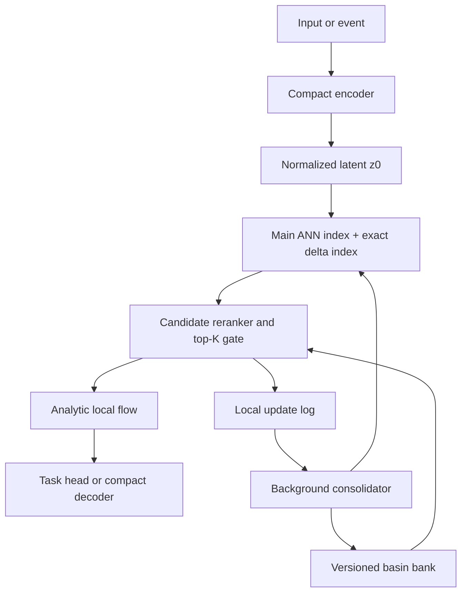

# Project ManifoldFlow — Design Doc v0.2

> A geometry-first sparse attractor memory without the VRAM apocalypse.

**Status:** Research prototype  
**Primary objective:** Test whether a sparse bank of local geometric attractors
can provide useful associative memory and continual adaptation with a bounded
per-query working set.  
**Initial domain:** Small-image representation, denoising, classification, and
continual-learning experiments.  
**Later domains:** Event streams, sensor monitoring, and language-state memory.

## 0. Executive summary

A compact encoder maps an input or event to a latent state. An
approximate-nearest-neighbor index retrieves a small candidate set. Each basin
defines a stable local quadratic energy model, and the state moves through the
local field with an analytic flow segment rather than a numerical ODE solver.
Only retrieved basins enter the forward pass or receive online updates. A
versioned background consolidator merges, splits, prunes, quantizes, and
reindexes basin state.

The central hypothesis is:

> A fixed compact backbone plus a growing sparse attractor bank can increase
> memory capacity while keeping per-query bank compute approximately constant,
> and local basin updates can reduce interference during continual learning.

The MVP contains continuous-time multistable dynamics with discrete point
attractors. Basin state remains learned state. Analytic integration removes
numerical ODE substeps, not ordinary encoder/decoder backpropagation. Exact
local flows freeze routing for one segment; a globally adaptive smooth mixture
does not generally have the same closed form. Cold four-bit storage is a later
measurement target, not the default update arithmetic.

## 1. Goals and non-goals

### Goals

1. Retrieve and evaluate a small candidate set independent of total bank size.
2. Guarantee contractive local flows by construction.
3. Update only active basins and a small append-only delta index online.
4. Keep the large bank/index in CPU memory or storage and transfer active rows.
5. Consolidate snapshots, validate proposals, and atomically publish versions.
6. Compare against simpler methods at matched memory and compute.

### MVP non-goals

- Replacing transformers, autoregressive decoders, or diffusion models.
- Generic generation from a CLIP-like embedding.
- A globally smooth field with an exact trajectory across arbitrary boundaries.
- Training one million natural basins in the first six weeks.
- Continual learning with no retained state.

Positive curvature in every latent direction gives each basin one stable point.
True line, ring, or surface attractors require zero-curvature tangent directions
and are reserved for a later low-rank extension.

## 2. Architecture

| Component | MVP decision |
| --- | --- |
| Encoder | Small modality-specific model; sweep widths 32, 64, 128, 256 |
| Normalizer | Fixed whitening or learned normalization frozen with encoder |
| Index | Immutable main HNSW/IVF-PQ plus small exact delta index |
| Reranker | Exact basin-specific energy over `M`; soft gate over best `K` |
| Bank | Versioned CPU tensors or memory-mapped shards |
| Flow | Diagonal positive rates; no numerical solver |
| Output | Linear/MLP head or compatible paired decoder |
| Consolidator | Separate snapshot process with validation and atomic swap |

Image reconstruction requires a compatible encoder/decoder pair. A frozen
discriminative encoder is suitable for retrieval/classification but cannot be
assumed to have a compatible decoder after projection.

## 3. Basin model and dynamics

A basin stores center $\mu_i\in\mathbb{R}^d$, unconstrained log-rate
$\rho_i\in\mathbb{R}^d$, bounded routing bias $b_i$, count $n_i$, diagonal
second moment $M2_i$, lifecycle metadata, optional task value state, and
optional split evidence.

The contraction rate is positive and bounded:

$$
\lambda_{ij}=\operatorname{clip}\left(
\lambda_{\min}+\operatorname{softplus}(\rho_{ij}),
\lambda_{\min},\lambda_{\max}\right).
$$

The local energy and exact gradient flow are:

$$
E_i(z)=\frac{1}{2}\sum_j\lambda_{ij}(z_j-\mu_{ij})^2-b_i,
$$

$$
\dot z=-\lambda_i\odot(z-\mu_i),\qquad
z(t)=\mu_i+(z_0-\mu_i)\odot e^{-\lambda_i t}.
$$

The bias affects routing preference, not within-basin contraction.

Routing has two stages. Retrieve `M` candidates from the main and delta indexes,
then rerank them by true anisotropic energy. For the best `K`:

$$
w_i=\operatorname{softmax}(-E_i(z_0)/\tau),
$$

$$
a=\sum_iw_i\lambda_i,\qquad
m=\frac{\sum_iw_i(\lambda_i\odot\mu_i)}{a},
$$

$$
z(t)=m+(z_0-m)\odot e^{-at}.
$$

The gate is frozen during the segment. This is exact for that local affine
field, but not for a globally adaptive soft mixture whose weights change with
$z$. Longer dynamics may reroute between a small number of segments, with
truncated gradients or detached routing boundaries made explicit.

Pure contraction provides cleanup and denoising. A later event-driven extension
may add a piecewise-constant drive:

$$
\dot z=-A_i(z-\mu_i)+G_i u.
$$

`G` should be shared, diagonal, or low rank to preserve sparse memory economics.

## 4. Learning modes

### Frozen-backbone statistical updates

Train/select the encoder and normalizer, initialize the bank, calibrate the
compact output module on original and gently flowed latents, then freeze the
backbone and output module. For an assigned observation:

$$
n_i'=n_i+1,\quad
\delta=z-\mu_i,\quad
\mu_i'=\mu_i+\eta_i\delta,\quad
M2_i'=M2_i+\delta\odot(z-\mu_i').
$$

Use $\eta_i=1/n_i'$ for stationary streams or a capped exponential rate for
nonstationary streams. Derive diagonal rates from inverse variance:

$$
\lambda_i=\operatorname{clip}\left(
c/(v_i+\epsilon),\lambda_{\min},\lambda_{\max}\right).
$$

Only active basins, value statistics, and the delta index change.

### Sparse task-optimized updates

Later experiments may apply sparse gradients to active centers, rates, biases,
and values. Objectives may combine task/reconstruction loss, attraction,
contrastive routing margin, boundary continuity, utilization, and anti-collapse
terms. Full-bank Adam state is prohibited by default. Encoder/decoder tuning is
optional and explicitly reintroduces global backpropagation, representation
drift, and index maintenance.

### Basin creation

Propose a basin only if no retrieved basin passes a calibrated threshold, the
novelty persists or has staging-buffer support, and capacity is available or a
lower-value basin can be safely retired. New or materially moved centers enter
the exact delta index until consolidation rebuilds the main index.

## 5. Background consolidation

Consolidation is structural maintenance, not low-precision full-bank gradient
descent:

1. Snapshot bank version `v`.
2. Continue foreground updates in an append-only delta log.
3. Consolidate in a separate process.
4. Build and validate the proposed bank/index.
5. Replay compatible foreground deltas.
6. Atomically publish `v+1`, retaining `v` for rollback.

| Operation | Required evidence and guardrail |
| --- | --- |
| Merge | Distributional overlap and compatible values; preserve sufficient statistics exactly; reject shadow-metric loss |
| Split | Persistent variance/multimodality plus subcluster evidence; mean/variance alone is insufficient |
| Prune | Low use, age, redundancy, negligible validation contribution; tombstone first and protect rare value |
| Smooth | Verified semantic neighbors and measured boundary instability; proximity alone is insufficient |
| Quantize | Per-field calibration plus routing-recall/downstream checks; update in FP16/FP32 |

Retained latent sketches count toward the memory budget even when raw examples
are not stored.

## 6. Memory and compute envelope

For one million basins at `d=64`, centers plus rates use 512 MB in FP32, 256 MB
in FP16, or 128 MB as INT8 vectors before metadata/scales. Biases and core
metadata add roughly 20–34 MB. An ANN index may add approximately 80–250 MB,
while values, sketches, snapshots, alignment, and allocator overhead are
workload-dependent. Full-bank Adam moments are disallowed.

Per query:

- candidate generation is index-dependent and approximately sublinear;
- exact reranking is $O(Md)$;
- top-K flow is $O(Kd)$; and
- typical active basin bytes remain below 1 MB, though transfer overhead may
  dominate arithmetic.

Hot active records live near compute. Warm quantized bank/index state lives in
CPU RAM or unified memory. Cold shards and old versions live on SSD. Random
single-basin SSD swaps are not a viable primary lookup path.

## 7. Training and evaluation sequence

1. **Representation:** paired autoencoder for reconstruction or frozen
   discriminative encoder for classification; sweep latent widths and freeze the
   primary backbone.
2. **Initialization:** collect normalized latents; create 1,000–10,000 basins
   with mini-batch K-means or an online mixture; calibrate the output module.
3. **Flow/local learning:** hard flow, soft top-K flow, then statistical updates,
   novelty staging, and a delta index. Sparse task gradients come later.
4. **Consolidation:** add versioning/rollback, merge, evidence-backed split,
   prune, quantization, and index rebuild separately behind shadow validation.

Required matched baselines are a frozen linear probe, exact latent k-NN,
nearest centroid/mini-batch K-means, online Gaussian mixture or RBF classifier,
VQ-style codebook, ManifoldFlow with `t=0`, and ManifoldFlow without
consolidation.

## 8. Six-week roadmap

| Week | Milestone | Exit condition |
| ---: | --- | --- |
| 1 | Encoder/decoder, latent sweep, baselines | Reproducible probe, k-NN, centroid, no-flow metrics |
| 2 | Basin store, exact energy routing, hard flow | Numerical tests match analytic solution; stable rates |
| 3 | Soft top-K and main-plus-delta ANN | Held-out ANN recall meets exact-routing target |
| 4 | Streaming updates and basin creation | Stable non-IID learning without encoder updates |
| 5 | Versioned consolidator | Shadow validation, atomic publish, rollback fault tests |
| 6 | Ablations, continual learning, scale simulation | Three seeds and 1M-basin systems benchmark |

ImageNet-1K and ViT-B comparisons are Phase 2.

## 9. Success and kill criteria

Systems gates:

- peak accelerator memory below 2 GB for the small-image MVP;
- active bank working set below 1 MB for `K<=8`, `d<=256`;
- INT8/PQ million-basin core bank plus index below 512 MB, excluding task
  payloads and rollback snapshots;
- ANN recall at least 95% for the exact top basin;
- bank lookup, rerank, and flow below 10 ms p95, and end-to-end inference below
  50 ms p95, on named hardware/settings; and
- sublinear query-latency growth from 10,000 to 1,000,000 basins.

Learning gates:

- clean quality within two points of the matched frozen-backbone baseline;
- repeatable noisy/non-IID gains over centroid, k-NN, VQ, and no-flow methods;
- consolidation improves memory/latency without meaningful three-seed quality
  loss; and
- no silent loss of rare classes or old tasks.

Kill or pivot when `t=0`, centroid, or VQ consistently matches the full method;
ANN misses dominate after adequate tuning; the target requires representation
learning but local updates only work with a frozen encoder; or decoder cost
dominates enough to reposition the method as an external memory module.

## 10. Initial build decision

- Run `d=64` and `d=128` in parallel.
- Use Fashion-MNIST and CIFAR-10.
- Freeze a paired autoencoder or discriminative encoder.
- Start with 1,000–10,000 basins.
- Establish exact routing before HNSW/IVF-PQ.
- Implement statistical updates before sparse gradients.
- Implement hard flow before soft top-K.
- Target INT8 cold storage and FP16/FP32 active compute.
- Use an immutable main index plus exact delta index.
- Make no diffusion-decoder, no-global-backprop, or ImageNet/ViT-B MVP claim.

The architecture earns its complexity only if analytic dynamics or validated
consolidation improves quality, robustness, continual-learning behavior, or
scaling beyond simpler matched baselines.

