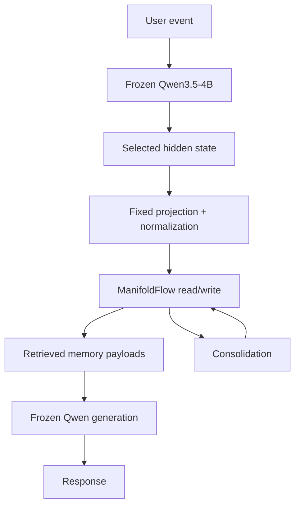
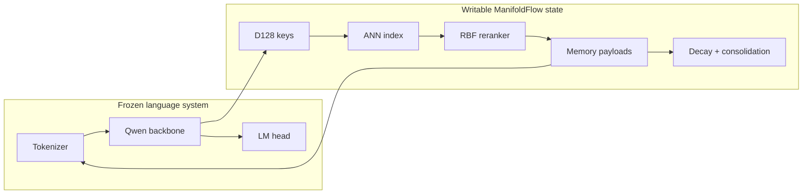
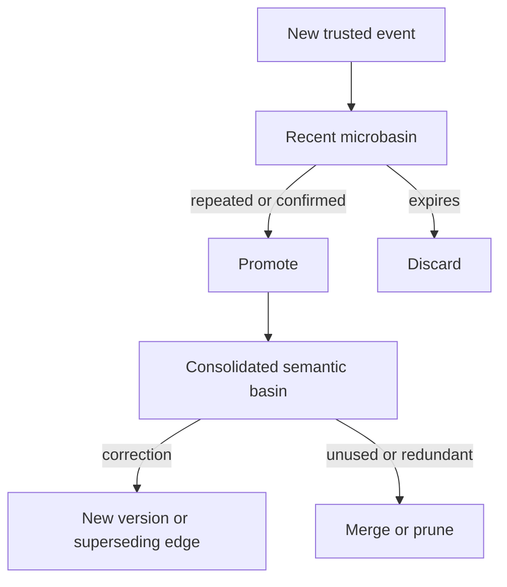
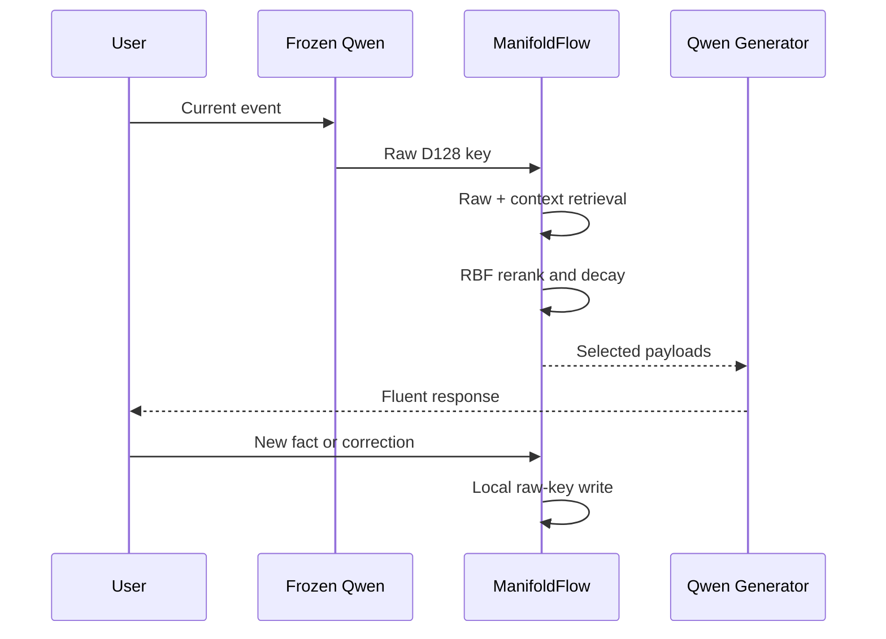
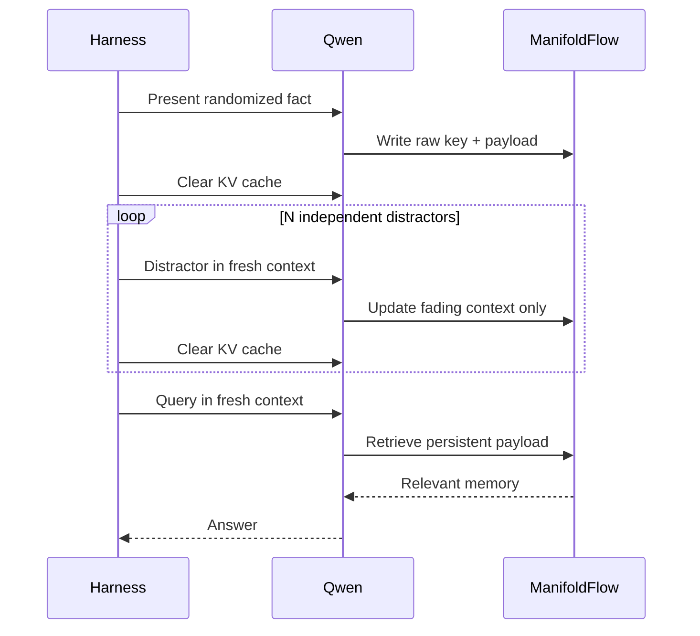

# ManifoldFlow + Qwen Continuous-Learning Testbed — Design Doc v0.3

*A frozen fluent language model with a writable geometric memory that learns continuously without backpropagation.*

**Status:** Ready for implementation  
**Testbed model:** Qwen3.5-4B, frozen  
**Memory system:** ManifoldFlow, online local updates  
**Primary question:** Can ManifoldFlow give a competent frozen language model persistent, immediately usable memory without changing the model’s weights?  
**Secondary question:** Does the graded contextual persistence observed in vision transfer to entity binding, corrections, and state tracking in language?

---

## 0. Executive Summary

The Qwen testbed isolates ManifoldFlow’s continuous-learning mechanism from the unresolved language quality of Sonic. Qwen3.5-4B supplies fluent language, contextual representations, and generation. Its weights remain frozen. ManifoldFlow extracts a stable key from a selected Qwen hidden layer, projects it to a compact normalized latent, and stores new information as locally updated geometric memory records. At query time, ManifoldFlow retrieves relevant payloads and inserts them into Qwen’s working context. Qwen verbalizes the result; ManifoldFlow owns the persistent writable state.



The first testbed deliberately does not replace Qwen’s language-model head. Making every basin predict vocabulary tokens would force ManifoldFlow to relearn grammar, consume a large token-payload table, and confound memory quality with generation quality. Instead, basins store natural-language or structured payloads. This directly tests the intended claim:

> A pretrained model can acquire persistent, immediately usable information through a sub-millisecond geometric memory whose online learning requires no gradient update.

This is not a claim that the complete stack was trained without backpropagation. Qwen was pretrained conventionally. The claim applies to post-deployment ManifoldFlow learning.

## 1. Evidence Motivating the Testbed

### 1.1 Static geometric learning

The initial image experiments established that the basic bank, routing, and local statistical updates function:

| Experiment | Result |
|---|---:|
| D64 ManifoldFlow held-out accuracy | 82.5% |
| D128 ManifoldFlow held-out accuracy | 84.9% |
| Matched k-NN reference | 85.0% |
| ImageNet Euclidean/RBF pilot | 99% |
| ImageNet energy pilot | 96% |

RBF generally outperformed analytic flow for clean, one-shot classification. Therefore RBF is the default read operator in this testbed; flow is disabled and retained as a later conditional dynamics experiment.

### 1.2 Persistent routing bias

The visual pilot also produced a genuine graded forgetting curve:

| Configuration | 5 distractors | 20 distractors | 50 distractors |
|---|---:|---:|---:|
| Stateless, `alpha=1.0` | 15.6% | 15.6% | 15.6% |
| `alpha=0.5`, `decay=0.9` | 46.7% | 26.7% | 16.7% |
| `alpha=0.5`, `decay=0.95` | 51.1% | 35.6% | 26.7% |

The useful signature is high near-term reassociation followed by gradual return toward the stateless floor. ANN latency remained approximately 0.5 ms p50.

At alpha=0.3, reassociation reached 96.7–100%, but class accuracy remained flat at 60% across distraction lengths. This is classified as context-pinning collapse: the new observation contributes too little to the query, so the system remains near its prior state instead of recognizing current content.

This yields a non-negotiable testbed rule:

> Retention is valid only while current-input responsiveness remains near the stateless baseline.

## 2. Goals and Non-Goals

### 2.1 Goals

1. Give frozen Qwen persistent state across cleared prompts, processes, or sessions.
2. Learn new facts, bindings, corrections, and preferences through local online writes.
3. Demonstrate graded forgetting under controlled distractors.
4. Preserve responsiveness to new and contradictory observations.
5. Maintain a stable frozen latent coordinate system and a small active working set.
6. Produce a test harness that can later replace Qwen with Sonic without changing ManifoldFlow semantics.

### 2.2 Non-goals

- Training Qwen or teaching language from scratch.
- Claiming that retrieved prompt text is a new generative architecture.
- Replacing Qwen’s token head in the first implementation.
- Using Qwen’s native context window as evidence of ManifoldFlow memory.
- Persisting every model-generated statement automatically.
- Demonstrating audio or multimodal memory in this phase.
- Treating class identity as sufficient evidence of instance memory.

## 3. System Boundaries



| Component | Frozen? | Learned online? | Responsibility |
|---|---:|---:|---|
| Qwen tokenizer | Yes | No | Text-token conversion |
| Qwen backbone | Yes | No | Contextual representation and language competence |
| Selected-layer capture | Yes | No | Extract stable event representation |
| D128 projection | Yes | No | Compact fixed coordinate system |
| Basin bank | No | Yes | Centers, spreads, evidence, and payload references |
| Context state | No | Yes | Fading temporal routing bias |
| ANN index | No | Yes | Candidate retrieval |
| Consolidator | No | Yes | Merge, split, prune, promote, expire, and reindex |
| Qwen LM head | Yes | No | Fluent response generation |

Freezing Qwen is architecturally important. If Qwen changes, its hidden geometry changes and stored keys become stale. Any later Qwen upgrade must create a new memory-key version or trigger controlled re-embedding of retained source payloads.

## 4. Representation Extraction

### 4.1 Event key

For an event containing content-token hidden states $H$ from layer $l$, construct:

$$
z_t = \operatorname{normalize}\left(R\,\operatorname{pool}(H_t^{(l)})\right),
\qquad z_t\in\mathbb R^{128},
$$

where $R$ is a fixed seeded projection. The same model revision, tokenizer, chat template, layer, pooling rule, projection seed, and normalization must be recorded in the bank manifest.

### 4.2 Initial representation sweep

Hold every other setting fixed and test:

- final hidden layer;
- approximately 75% network depth;
- approximately 50% network depth;
- last content token pooling;
- mean pooling over content tokens.

Select the representation using stateless retrieval only. Do not select it using persistence scores, because that would mix representation quality with the memory mechanism under test.

### 4.3 Canonical runtime

Use the post-trained Qwen3.5-4B checkpoint in Hugging Face Transformers for the canonical experiment because the testbed needs hidden-state access. Use BF16 when it fits the target accelerator. Quantized inference is a later systems ablation because quantization can slightly alter the latent geometry even when generation quality appears unchanged.

Capturing all hidden layers wastes memory. The prototype may use `output_hidden_states=True`; the measured implementation should capture only the selected layer through a targeted hook.

## 5. Memory Model

### 5.1 Record types

The bank contains two conceptual tiers.



Recent microbasins support one-shot acquisition. They preserve an individual event without immediately deforming a mature semantic centroid.

Consolidated basins summarize repeated compatible observations and carry higher-confidence, longer-lived payloads.

### 5.2 Basin record

Each basin stores:

```text
basin_id
center[D]
diagonal_variance[D]
observation_count
confidence
created_at / last_used_at
source_type and trust tier
payload references
supersedes / contradicted_by links
context half-life
bank and encoder version
```

Payloads begin as either:

1. natural-language memory statements; or
2. structured triples/state records such as entity → relation → value.

The geometric key controls retrieval. The payload remains recoverable and inspectable rather than being irreversibly compressed into a token histogram.

### 5.3 Source policy

Durable writes may come from:

- user-provided statements;
- explicit corrections;
- imported trusted material;
- externally verified results;
- accepted outcomes or confirmed actions.

Qwen’s unsupported generated claims must not become durable semantic memory. They may occupy ephemeral working state until confirmed.

## 6. Persistent Context and Anti-Collapse Routing

### 6.1 Context state

Under the current alpha convention, the contextual query is:

$$
q_t = \operatorname{normalize}\left(\alpha_t z_t + (1-\alpha_t)c_{t-1}\right).
$$

The context state decays by event count. For scalar decay $\gamma$, its half-life is:

$$
h=\frac{\ln 0.5}{\ln\gamma}.
$$

| Decay | Approximate event half-life |
|---:|---:|
| 0.90 | 6.6 events |
| 0.95 | 13.5 events |
| 0.98 | 34.3 events |

The first language run uses alpha=0.5–0.7 and decay=0.95. Values below alpha=0.5 are excluded until an adaptive gate is proven.

### 6.2 Two-pass candidate retrieval

A blended vector must not be allowed to hide candidates supported by the current observation. Retrieve separately:

$$
C_z=\operatorname{ANN}(z_t),\qquad C_c=\operatorname{ANN}(c_{t-1}).
$$

Rerank the union $C=C_z\cup C_c$ with

$$
S_i=\alpha_t S_i(z_t)+(1-\alpha_t)g_tS_i(c_{t-1}),
$$

where $g_t$ is a compatibility gate. RBF is the canonical score:

$$
S_i(x)=\exp\left(-\frac{\lVert x-\mu_i\rVert^2}{2\sigma_i^2}\right).
$$

### 6.3 Adaptive compatibility gate

The first fixed-alpha experiment establishes reproducibility. The next implementation adds a deterministic gate based on raw-route evidence:

| Situation | Required behavior |
|---|---|
| Observation and context agree | Permit strong context bias |
| Observation is ambiguous, context confident | Permit moderate context bias |
| Observation is confident and conflicts | Raise `alpha` toward 1 |
| Novel observation or topic switch | Use `alpha=1`; weaken or fork context |
| Explicit reset/forget instruction | Clear targeted context state |

The gate should compare raw and contextual candidate distributions, not merely cosine similarity between two embeddings.

### 6.4 Read/write separation

Context may alter reads. It must not contaminate semantic writes. For a winning basin $i$, update its center from the raw observation:

$$
\mu_i' = \mu_i + \eta_i(z_t-\mu_i),
$$

never from the blended query $q_t$. Otherwise temporary sequence context permanently bends the stored semantic geometry.

## 7. Inference and Online-Learning Path



### 7.1 Read path

1. Apply the fixed chat template to the current event only.
2. Run frozen Qwen and capture the selected hidden representation.
3. Pool, project, and normalize to obtain raw key $z_t$.
4. Retrieve raw-observation and persistent-context candidates.
5. Rerank their union using RBF and compatibility gating.
6. Apply confidence, trust, recency, and contradiction filters.
7. Select a small payload set within a strict token budget.
8. Inject selected payloads into a clearly delimited memory block.
9. Generate the answer using frozen Qwen.
10. Update ephemeral context state.

Suggested injection format:

```text
<persistent_memory>
- [confirmed] Velan's vehicle is the blue truck.
- [corrected] Mira is now in Box 9, superseding Box 4.
</persistent_memory>
```

The model must be instructed that memory may be absent, uncertain, or superseded and that it should not invent missing records.

### 7.2 Write path

1. Classify the event source and trust level.
2. Extract a raw key without memory injection.
3. Search for compatible existing records.
4. Update a compatible recent record or create a microbasin.
5. Store the original inspectable payload and provenance.
6. Add the center to the exact delta index.
7. Defer structural merge, split, and main-index rebuild to consolidation.

### 7.3 Corrections

Corrections must not be averaged indiscriminately with obsolete facts. A correction creates a new version or superseding edge:

```text
Mira → location → Box 4   [superseded]
Mira → location → Box 9   [current]
```

Retrieval excludes superseded values by default while retaining history for auditing and temporal questions.

## 8. Evaluation Isolation

Qwen’s native context can counterfeit persistent memory. The original fact must therefore be absent from Qwen’s query-time context.



### 8.1 Required controls

| Condition | ManifoldFlow persists? | Original fact visible at query? | Purpose |
|---|---:|---:|---|
| Stateless Qwen | No | No | Pretraining/guessing floor |
| Ordinary prompt memory | No | Yes | Qwen upper reference |
| MF reset | Reset before query | No | Detect harness leakage |
| Stateless MF | Yes, `alpha=1` | No | Bank without temporal bias |
| Persistent MF | Yes | No | Target mechanism |
| Shuffled payload | Yes | No | Detect prompt-format artifacts |

Every query must start with a fresh KV cache and omit the source fact unless it is the explicit prompt-memory control.

### 8.2 Episode generator

Use randomized nonce entities and relations so Qwen cannot answer from pretrained knowledge:

```text
Neral owns the copper glider.
Tovan placed the striped lantern in Vault 7.
Mira moved from Box 4 to Box 9.
```

Generate the following episode families:

- fact introduction and delayed query;
- entity–attribute binding;
- same-type hard negatives;
- state update and latest-value query;
- explicit correction;
- unknown/zero answer;
- topic switch;
- instruction selection;
- conversation-state binding;
- explicit memory reset;
- repeated confirmation;
- contradiction from different trust tiers.

Use distraction gaps:

$$
n\in\{0,1,2,5,10,20,50,100,200\}.
$$

For each episode, regenerate entity names, values, ordering, phrasing, and distractors. Hold out templates as well as surface values.

### 8.3 Metrics

Report at minimum:

- exact answer accuracy;
- semantic answer accuracy;
- retention curve by distraction gap;
- area above stateless retention floor;
- current-input responsiveness;
- same-type instance confusion;
- false stale-memory carryover;
- correction success;
- unknown-answer precision;
- memory creation, retrieval, and end-to-end latency;
- bank size and bytes per durable memory;
- retrieved-payload token overhead.

Use the constrained score:

$$
J=\sum_n w_n\left[R(n)-R_{\text{stateless}}\right]
-\lambda F_{\text{carry}}-\mu L_{\text{current}}.
$$

A configuration is invalid regardless of $J$ if:

$$
A_{\text{current}} < A_{\text{stateless}}-2\text{ percentage points}.
$$

This is the formal context-collapse detector motivated by the alpha=0.3 result.

## 9. Training and Calibration Plan

The testbed has no end-to-end optimization loop. “Training” consists of representation selection, streaming bank construction, local payload updates, and held-out calibration of routing controls.

### Phase 0 — Plumbing and deterministic replay

- Load frozen Qwen3.5-4B.
- Capture one selected hidden layer.
- Implement deterministic D128 projection and normalization.
- Log model, tokenizer, template, layer, projection seed, and bank versions.
- Build reproducible save/reload and event replay.

**Exit gate:** Identical text produces stable keys and retrieval after restart.

### Phase 1 — Representation selection

- Compare three layers and two pooling rules.
- Use stateless entity/fact retrieval only.
- Measure nearest-neighbor separation, held-out retrieval, and latency.
- Select one representation and freeze the decision.

**Exit gate:** Selected representation materially exceeds random and lexical-only controls on paraphrased held-out queries.

### Phase 2 — Static semantic bank

- Build basins with alpha=1.
- Store raw keys and structured/text payloads.
- Validate RBF against Euclidean, energy, and k-NN references.
- Calibrate novelty threshold and microbasin creation.

**Exit gate:** The bank retrieves correct payloads without temporal context and does not show uncontrolled basin growth.

### Phase 3 — Fixed persistent context

- Enable alpha in `{0.5, 0.6, 0.7}`.
- Sweep decay in `{0.90, 0.95, 0.98}`.
- Run all distraction gaps and topic-switch controls.
- Enforce the current-input accuracy constraint.

**Exit gate:** A graded forgetting curve appears above the stateless floor without context collapse.

### Phase 4 — Adaptive gate

- Add separate raw and contextual retrieval.
- Use candidate agreement, raw confidence, and novelty to choose $\alpha_t$.
- Add explicit reset, correction, and contradiction handling.
- Test whether adaptive gating dominates the best safe fixed configuration.

**Exit gate:** Better retention/carryover tradeoff than fixed alpha at matched current-input accuracy.

### Phase 5 — Continual write lifecycle

- Enable one-shot microbasins.
- Add repetition-based promotion.
- Add expiration, supersession, and trusted-source rules.
- Run long non-IID streams with bank growth and forgetting measurements.

**Exit gate:** New memories are immediately usable; corrections replace obsolete values; unrelated competence does not degrade materially.

### Phase 6 — Consolidation and scale

- Snapshot the active bank.
- Merge compatible microbasins.
- Split heterogeneous basins only when retained evidence supports it.
- Prune expired or redundant records.
- Rebuild and atomically swap the main ANN index.
- Benchmark 10K, 100K, and 1M synthetic/real records.

**Exit gate:** Consolidation preserves evaluation accuracy within tolerance and foreground reads remain available.

### Phase 7 — Sonic portability

- Implement the same representation-adapter interface for Sonic.
- Rebuild the bank in Sonic’s coordinate system; do not reuse Qwen keys.
- Run the identical episodic harness.
- Compare memory curves independently of generation quality.

**Exit gate:** The ManifoldFlow mechanism transfers; any remaining conversational limitation can be attributed to Sonic’s representation or generator.

## 10. Initial Configuration

```yaml
backbone:
  model: Qwen/Qwen3.5-4B
  frozen: true
  precision: bf16
  kv_cache_reset_between_eval_events: true

representation:
  dimension: 128
  projection: fixed_seeded
  normalization: l2
  layer: sweep_50_75_100_percent
  pooling: sweep_last_token_mean

memory:
  score: rbf
  flow_enabled: false
  recent_microbasins: true
  consolidated_bank: true
  payload_top_k: 4
  payload_token_budget: 512

context:
  alpha_candidates: [0.5, 0.6, 0.7]
  decay_candidates: [0.90, 0.95, 0.98]
  initial_default_alpha: 0.6
  initial_default_decay: 0.95
  write_from_raw_observation: true
  two_pass_retrieval: true

index:
  main: ann
  recent_delta: exact
  candidate_count_per_path: 32
  rerank_union: true
```

These are starting points, not claimed optima. The canonical setting is selected on held-out episode templates under the anti-collapse constraint.

## 11. Instrumentation

Every event should emit a compact machine-readable trace:

```text
event_id
raw_top_candidates and scores
context_top_candidates and scores
candidate overlap
chosen alpha and decay
context confidence
novelty score
selected payload IDs and versions
write action: none/update/create/supersede
ANN, rerank, injection, generation latency
bank and encoder version
```

Every evaluation summary should include:

```text
retention curve
stateless floor
current-input accuracy
false carryover rate
correction accuracy
unknown-answer precision
bank growth
memory bytes
p50/p95 routing latency
retrieved prompt tokens
```

This makes context-pinning collapse visible even when headline reassociation accuracy looks excellent.

## 12. Risks and Mitigations

| Risk | Failure signature | Mitigation |
|---|---|---|
| Qwen native context leaks the answer | MF-reset control still succeeds | Fresh KV cache and isolated prompts |
| Context pinning | High retention, flat or damaged current accuracy | Raw-route union, adaptive alpha, hard accuracy gate |
| Semantic rather than instance recall | Same-class substitutions | Randomized entities and same-type hard negatives |
| Representation drift | Old keys stop retrieving | Freeze and version Qwen; rebuild on upgrades |
| Generated-error feedback | Model mistakes become durable | Trusted-source write policy |
| Contradictory averaging | Old and new facts blend | Supersession/version links |
| Prompt injection through memory | Retrieved payload changes control behavior | Delimited data-only memory block and trust filtering |
| Unbounded bank growth | Microbasins proliferate | Novelty staging, expiration, promotion, consolidation |
| Retrieval looks good but does not affect answers | Correct payload retrieved, wrong response | Report retrieval and answer accuracy separately |
| Quantization changes geometry | Retrieval differs across runtimes | BF16 canonical bank; quantization-specific bank version |

## 13. Success Criteria

The Qwen testbed succeeds when all of the following hold:

1. Qwen recalls randomized information after its native context and KV cache are cleared.
2. Persistent ManifoldFlow materially outperforms stateless Qwen and MF-reset controls.
3. Recall degrades gradually with distraction rather than vanishing immediately or remaining suspiciously flat.
4. Current-input accuracy stays within two percentage points of the stateless baseline.
5. Same-type hard negatives show genuine instance/entity binding rather than class persistence.
6. Corrections supersede stale facts reliably.
7. Unknown questions do not trigger confident unrelated memory retrieval.
8. New trusted facts become usable immediately without a gradient update.
9. Routing and memory updates remain negligible relative to Qwen generation latency.
10. The entire experiment can be replayed with a fresh bank from an event log.

The strongest defensible result would be:

> Frozen Qwen3.5-4B acquired persistent, correctable, graded memory through local ManifoldFlow updates, retained responsiveness to new inputs, and required no post-deployment backpropagation.

## 14. Immediate Next Steps

1. Implement the Qwen representation adapter and deterministic D128 key extraction.
2. Port the existing ManifoldFlow RBF bank behind a modality-independent encode/read/write/reset interface.
3. Build the fresh-context episodic harness using the existing randomized distractor families.
4. Establish stateless Qwen, MF-reset, and ordinary-prompt controls.
5. Select the Qwen layer and pooling rule with context disabled.
6. Reproduce the alpha=0.5–0.7 graded forgetting curve in language.
7. Add raw/context candidate-union routing and the context-collapse detector.
8. Add inspectable text/triple payloads, corrections, and supersession.
9. Introduce recent-versus-consolidated memory tiers.
10. Scale the bank only after correctness and isolation controls pass.

Do not add flow, token-level ManifoldFlow decoding, trainable projections, multimodality, or Qwen fine-tuning until the persistent-memory claim survives these controls.

## 15. Reference Interfaces

The implementation should keep the language model and memory system replaceable:

```python
class RepresentationAdapter:
    def encode_event(self, text: str) -> "Vector[D]": ...
    def generate(self, prompt: str, memories: list[str]) -> str: ...
    def clear_runtime_context(self) -> None: ...

class ContinuousMemory:
    def read(self, raw_key: "Vector[D]", session_id: str) -> list["MemoryHit"]: ...
    def write(self, raw_key: "Vector[D]", payload: "Payload", source: "Source") -> str: ...
    def advance_context(self, raw_key: "Vector[D]", session_id: str) -> None: ...
    def reset_context(self, session_id: str) -> None: ...
    def consolidate(self) -> "BankVersion": ...
```

Qwen and Sonic should implement the same `RepresentationAdapter`. ManifoldFlow must not contain Qwen-specific assumptions beyond the recorded representation manifest.
